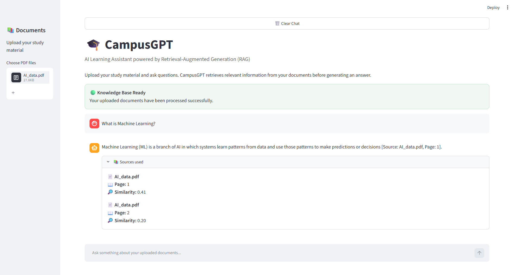
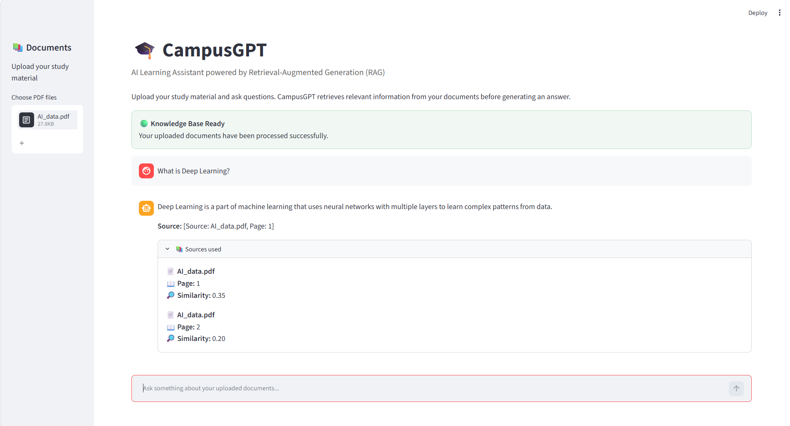
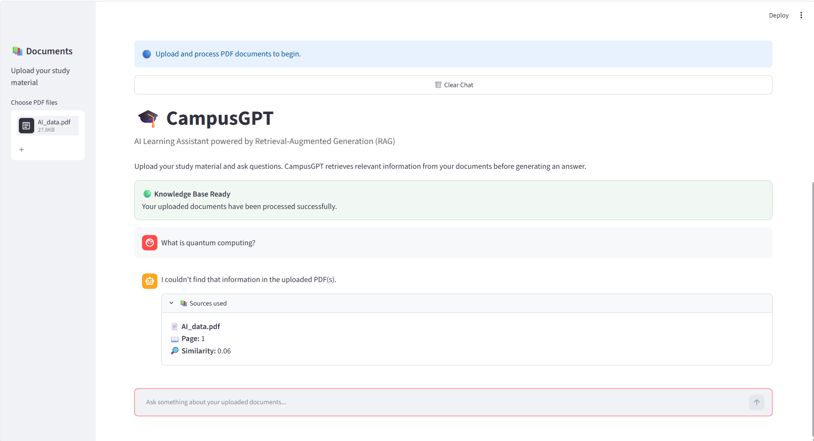

# 🎓 CampusGPT — PDF-Based RAG Chatbot

An AI-powered learning assistant that answers questions from uploaded PDF documents using Retrieval-Augmented Generation (RAG).

Developed as a minor project during my Data Science internship at Inspireleap.

## 🚀 Features

- Upload and process PDF documents
- Ask questions in natural language
- Retrieve relevant document passages
- Generate answers using Google Gemini
- Display source filenames and page numbers
- Show similarity scores
- Handle questions not supported by the documents
- Interactive Streamlit chat interface

## 🛠️ Tech Stack

- Python
- Streamlit
- Google Gemini API
- FAISS
- TF-IDF (Scikit-learn)
- PyPDF
- NumPy

## 🧠 How It Works

1. Users upload PDF documents.
2. Text is extracted and divided into chunks.
3. TF-IDF converts the chunks into vectors.
4. FAISS retrieves relevant chunks for a question.
5. Gemini generates an answer using retrieved context.
6. The application displays answers with source citations.

## 📸 Application Screenshots

### 1. Machine Learning Question


### 2. Deep Learning Question


### 3. Unsupported Question Handling


## ⚙️ Installation

Clone the repository:

```bash
git clone https://github.com/ditya0101gupta-svg/CampusGPT-PDF-RAG-Chatbot.git
cd CampusGPT-PDF-RAG-Chatbot
```

Install dependencies:

```bash
pip install -r requirements.txt
```

Create a `.env` file:

```env
GEMINI_API_KEY=your_api_key_here
```

Run the application:

```bash
streamlit run app.py
```

## 🔐 Security

API keys are stored in environment variables and are not included in the repository.

## 📌 Project Information

**Project:** CampusGPT — PDF-Based RAG Chatbot

**Organization:** Inspireleap

**Project Type:** Data Science Internship Minor Project

**Focus:** Generative AI, Natural Language Processing, and Retrieval-Augmented Generation

## 👨‍💻 Developer

Ditya Gupta

[GitHub Profile](https://github.com/ditya0101gupta-svg)
